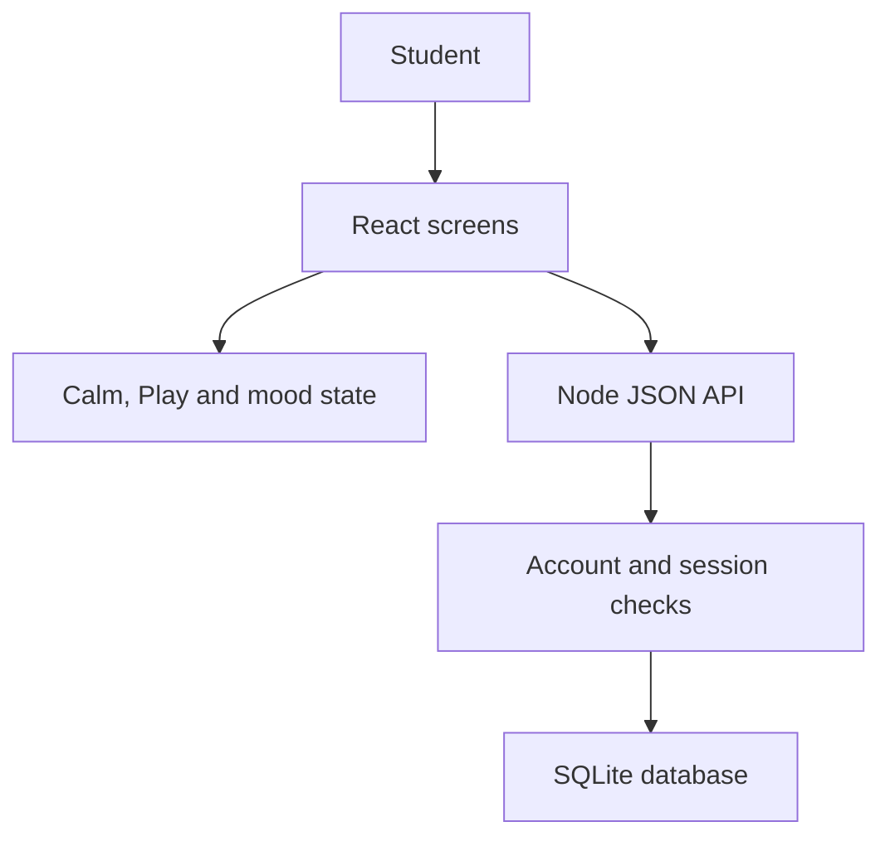

# BenSpace full-stack React demo

BenSpace includes college-ID registration, optional mood check-ins and daily quotes, three Calm exercises, two playable games, peer support, and appointment booking. It uses fictional profiles and two sample student IDs.

## 1. Run the completed app

Install Node.js 24 LTS. Extract the ZIP and open the `benspace-full` folder in VS Code. Run commands from the folder containing `package.json`.

**Terminal 1**

```bash
node --version
npm ci
npm run api
```

**Terminal 2**

```bash
npm run dev
```

Open [http://localhost:5173](http://localhost:5173). Select **Sign up** and enter `BU-DEMO-001`, then `246810`. Use `BU-DEMO-002` with the same sample code to test a second student in a separate browser profile. Use **Sign in** for an ID you already registered.

The API runs on port 3001. Vite forwards requests beginning with `/api` to it. When starting the API, Node automatically creates `var/benspace.sqlite` and applies the schema. Keep the two terminals running. To check the backend independently, open [http://localhost:3001/api/health](http://localhost:3001/api/health). It should return `{"ok":true}`.

```bash
npm test
npm run build
npm run preview
```

The preview uses port 4173 and still needs the API terminal. Run `npm run build` before previewing. An API process restart preserves accounts and bookings. For a fresh demo, stop the API and move the `var` directory aside before restarting.

## 2. How the pieces fit together



| Module | React flow | Data and backend |
| --- | --- | --- |
| Registration | Sign up → College ID → Verification → Home | API verifies sample credentials, creates student and session rows, then issues an HttpOnly cookie |
| Sign in | College ID → Verification → Home | API checks the existing account. Refresh checks the session with `GET /api/me` |
| Mood and quote | Home → optional mood → quote and next step | Mood stays in React memory. Seven original quotes per mood rotate by date in IST |
| Calm | Calm → Breathing, Grounding or Quiet Pause | Local timers and steps. No activity history |
| Play | Play → Memory Match or Word Scramble | Local game state. No scoreboard or account data |
| Peer Support | Home → Peer mentors → topic/language → profile | Profiles come from SQLite. A peer appointment uses the same booking API as counsellor and faculty sessions |
| Appointments | Provider → mode → slot → review → confirm | API writes the booking. Home and My appointments read the student’s own bookings. Reschedule and cancel update SQLite |
| Read & Reflect | Home → topic → article | Sample articles in `src/data.js` |
| Urgent help | Header → support contacts | Visible without signing in. Campus contact awaits Bennett confirmation |

## 3. Step-by-step build order and code

The complete code for every step is included. Open the file listed at each step to follow the implementation in order.

### Step 1 · Set up React and connect Vite to the API

Start with `package.json`, `index.html`, and `vite.config.js`. The HTML provides a root element and loads `src/main.jsx`. React mounts with `createRoot(document.getElementById('root')).render(<App />)`. In Vite, point the API proxy to Node.

```js
const proxy = { '/api': 'http://127.0.0.1:3001' }
```

Put shared fetch code in `src/api.js`. Keep API URLs relative so the browser uses the same origin and sends its session cookie.

```js
const response = await fetch('/api' + path, {
  method,
  headers: body ? { 'Content-Type': 'application/json' } : undefined,
  body: body ? JSON.stringify(body) : undefined,
})
```

### Step 2 · Create tables and seed the demo

Read `server/schema.sql`, then the `createApi` function in `server/index.js`. Open the SQLite file, execute the schema, and seed the provider table using `src/data.js`. The API inserts sample times on upcoming days as the directory is opened.

| Table | Key fields and purpose |
| --- | --- |
| students | `college_id`, registration timestamp |
| sessions | Hash of the random cookie token, college ID, expiry |
| providers | ID, name, role, focus areas, bio, languages |
| slots | Slot ID, provider ID, UTC start time |
| bookings | Booking ID, owner’s college ID, slot ID, mode, optional sample note, cancellation timestamp |

A database index prevents a second active booking for the same slot even if two clients submit it.

```sql
CREATE UNIQUE INDEX IF NOT EXISTS one_active_booking_per_slot
  ON bookings(slot_id) WHERE cancelled_at IS NULL;
```

### Step 3 · Build the registration and sign-in screens

In `src/main.jsx`, start with the `Access` component. Hold `action`, `step`, `id`, `code`, `busy`, and `error` in React state. The first Continue click checks the sample ID and reveals the code field. The second submits to the API.

```js
const student = await api('/auth/verify', 'POST', {
  collegeId: id,
  code: code.trim(),
  action,
})
onEnter(student)
```

In the server handler, verify the sample ID and code before creating a student row or issuing a session. Store only the session token hash in SQLite. Derive the booking owner from the session on the server.

### Step 4 · Build Home and daily quotes

In `src/data.js`, the quote bank has seven options per mood plus seven neutral quotes. The helper derives an IST day number, then indexes the chosen list. In `src/main.jsx`, changing the mood immediately re-renders the quote.

```js
export function dailyQuote(mood, now = Date.now()) {
  const options = quotes[mood] ?? quotes.Neutral
  const dayInIndia = Math.floor((now + 19800000) / 86400000)
  return options[dayInIndia % options.length]
}
```

The same mood shows the same quote on the same IST day whenever Home renders. The demo does not save mood selections to SQLite or send them to a mentor.

### Step 5 · Build Calm and Play

Follow `Breath` in `src/main.jsx` for the two-minute timer. Track elapsed time from a monotonic clock and stop at 120 seconds. CSS disables the animation when reduced motion is requested. In `src/activities.jsx`, build `Grounding` from an array of five prompts and `QuietPause` from a 60-second countdown. The games use local state for matched cards, the current word and feedback. Their results never go to the API.

### Step 6 · Build Peer Support and appointments

Load providers and availability from `GET /api/directory`. Filter peer mentors by language and topic in React. In the `Profile` component, select a mode and slot, display a review step, and submit only after confirmation.

```js
const booking = await api('/bookings', 'POST', { slotId, mode, note })
```

The server checks that the slot is in the future, the mode is allowed, and the student has no active booking at the same sample start time. A stale or taken slot returns HTTP 409, and the frontend refreshes availability. Rescheduling updates the same booking row. Cancellation records a timestamp and releases the slot.

### Step 7 · Verify the complete journey

1. Sign up as the first sample student. Try an incorrect code, then the valid one.
2. Select **Low**, read the daily quote, and open Peer Support. Test language and topic filters.
3. Complete a grounding exercise and solve a word scramble. Pause and resume breathing.
4. Book a sample peer session and refresh the page. Check that the booking stays on Home and in **Your sessions**.
5. Sign in as the second student in a separate profile. Check that the first student’s appointments are absent and the same slot is unavailable.
6. Reschedule and cancel as the first student. Sign out and check Urgent help still opens.

## 4. API reference for this demo

| Endpoint | Input | Result |
| --- | --- | --- |
| GET /api/health | None | API readiness |
| POST /api/auth/verify | collegeId, code, action | Student ID and session cookie |
| GET /api/me | Cookie | Signed-in student ID |
| POST /api/auth/logout | Cookie | Revoked session |
| GET /api/directory | Cookie | Providers and future slots with availability |
| GET /api/bookings | Cookie | Own active bookings |
| POST /api/bookings | slotId, mode, note | Created booking |
| PATCH /api/bookings/:id | slotId, mode, note | Rescheduled booking |
| DELETE /api/bookings/:id | Cookie | Cancellation confirmation |

## 5. Campus rollout

This is a local, single-server demo with a known verification code, simulated appointments and no reminder delivery. Use sample information only. The API deliberately binds to localhost. The rollout requires Bennett’s identity verification, real provider schedules and contact information, and university-approved privacy and safeguarding procedures. See `docs/CAMPUS_ROLLOUT.md` for the proposed production protocol. Its production API paths are a future contract, separate from the implemented demo paths above.

References: [Node.js SQLite](https://nodejs.org/api/sqlite.html) and [Vite proxy configuration](https://vite.dev/config/server-options#server-proxy).
